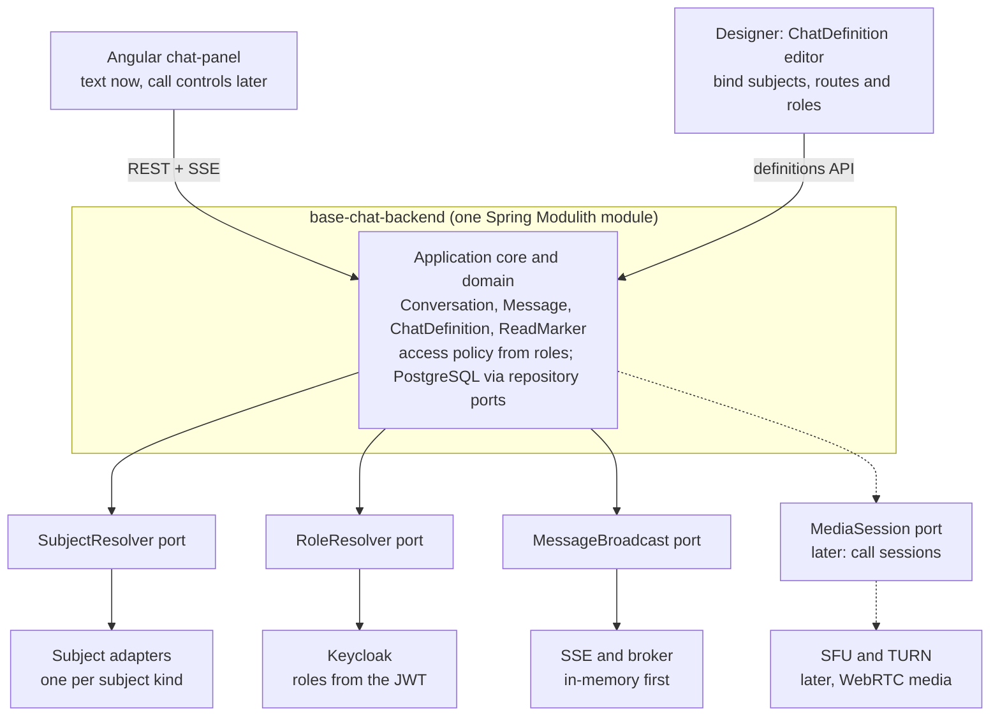

# ProcessPuzzle Chat – Architectural Blueprint

2026-11-15

## Goals and non-goals

Chat becomes a generic platform capability: a designer binds a conversation to almost any platform object or opens ad-hoc topic chats on a route, and role-based policies decide who takes part. Version 1 is text only, but the design must not block voice and video later.

**Goals (v1)**

- Bind a conversation to a subject: an entity instance, a workflow instance, a rule, or any future subject kind.
- Support ad-hoc topic chats on a configured route, created by the designer or, if allowed, by users at runtime.
- Configure participants in the designer from existing Keycloak roles, separately for reading and writing.
- Deliver messages live, keep history, and show unread counts.
- Embed the chat panel in entity, workflow and rule views through the existing widget embedding.
- Version chat definitions together with other definitions in the release and migration concept.

**Non-goals (v1, deferred)**

- Voice and video calls (designed for, see the evolution section).
- Threads, reactions, attachments, search, typing indicators, presence, push notifications.
- Federation with external chat systems such as Matrix or Teams (possible later as an adapter).

## Constraints

The feature must fit the existing platform conventions and must not introduce a second identity or permission system.

- **Stack:** Spring Boot with Spring Modulith, hexagonal architecture, Angular signals-first frontend, Nx monorepo.
- **Identity:** Keycloak is the single source of truth for users and roles. Chat never stores its own role membership.
- **Metadata-driven:** chat behaviour is configured through definitions (YAML, released with other definitions), not hard-coded per feature.
- **Module isolation:** `base-chat-backend` depends on no other base-* module directly. Subjects are reached through ports.
- **Hosting:** self-hosted staging and production; no mandatory SaaS dependency. Customer message data stays on the platform's own infrastructure (GDPR).
- **Multi-tenancy:** every conversation belongs to an organization, and all queries are tenant-scoped like other platform data.
- **Persistence:** messages are high-volume append-only data and live in plain relational tables, not in the EAV/JSONB entity layer.
- **Evolvability:** text is the first media type. Transport, storage and media must sit behind ports so voice and video can be added without reworking the model.
- **Operations:** works behind a standard reverse proxy; must run with more than one backend instance.

## Architecture overview

Text chat is the first capability of a conversation core that knows nothing about entities, workflows, Keycloak or media servers. Each of those sits behind a port, which is why calls can be added later without touching the text path.



Solid parts ship in v1; the dashed media port and SFU stay empty until voice and video are built.

## Domain model

The model has a definition side (designer-authored, released) and a runtime side (conversations and messages). The conversation is the stable aggregate; text messages are one kind of content, so later call sessions can attach to the same conversation.

**Definition side**

| Element | Fields | Purpose |
| --- | --- | --- |
| ChatDefinition | key, scope (SUBJECT or TOPIC), lifecycle, participantPolicy, postingPolicy | Designer-authored binding |
| SubjectBinding | subjectType, subjectDefinitionKey | Which kind of object gets a chat (SUBJECT scope) |
| TopicRoute | route pattern, route params | Where ad-hoc chats live (TOPIC scope), e.g. `/races/:raceId/protests` |
| ParticipantPolicy | readRoles, writeRoles, createRoles, includeSubjectOwner | Who may see, post and open chats, resolved from Keycloak roles |
| Lifecycle | AUTO_CREATE, ON_DEMAND, STATE_BOUND | When the conversation exists and when it is writable |

**Runtime side**

| Element | Fields | Notes |
| --- | --- | --- |
| Conversation | id, tenantId, chatDefinitionKey, subjectType, subjectId, topic, routeParams, status, createdBy, createdAt | One per (definition, subject) for SUBJECT chats; status OPEN, CLOSED or ARCHIVED |
| Message | id (monotonic), conversationId, authorId, kind, body, createdAt, editedAt, deletedAt | `kind` is TEXT in v1; SYSTEM and CALL_EVENT come later |
| ReadMarker | conversationId, userId, lastReadMessageId | Unread count = messages with id greater than the marker |
| Participant (optional) | conversationId, userId, addedBy | Explicit invitations; off in the MVP |

Participation is computed at access time from roles, not copied into the conversation, so a role change takes effect immediately. The subject is referenced by type and id only, resolved through a port.

## Backend structure

One Spring Modulith module, `base-chat-backend`, in hexagonal layers. Other modules plug in through ports and application events, never through direct dependencies.

```
base-chat-backend
  domain/        Conversation, Message, ChatDefinition, ParticipantPolicy, ReadMarker
  application/   OpenConversation, PostMessage, ListMessages, MarkRead,
                 ResolveAccess, ChatDefinitionService
  port/in        ChatCommands, ChatQueries
  port/out       ConversationRepository, MessageRepository, ChatDefinitionRepository,
                 MessageBroadcastPort, RoleResolverPort, SubjectResolverPort,
                 CurrentUserPort, MediaSessionPort (reserved, later)
  adapter/in     REST controllers, SSE endpoint
  adapter/out    JPA repositories, SSE/broker broadcaster, Keycloak role adapter
```

**Key ports**

| Port | Responsibility | Implemented by |
| --- | --- | --- |
| SubjectResolverPort | Does the subject exist; who owns it; which state is it in; may this user see it | One adapter per subject kind in base-entity, base-workflow and the rule module |
| RoleResolverPort | Roles of the current user in the current tenant | Keycloak/JWT adapter |
| MessageBroadcastPort | Fan a stored message out to connected clients across instances | In-memory (single node), then broker or Postgres LISTEN/NOTIFY |
| MediaSessionPort | Create and end call sessions, issue join tokens | Reserved; empty until voice/video |

**Events (Spring Modulith)**

- Published: `MessagePosted`, `ConversationOpened`, `ConversationClosed`. Notification, audit and workflow modules subscribe.
- Consumed: subject lifecycle events (`WorkflowInstanceCompleted`, entity state changes) to close or reopen STATE_BOUND conversations.

**Persistence:** plain tables `chat_definition`, `chat_conversation`, `chat_message`, `chat_read_marker`, managed by Flyway. Messages are indexed on `(conversation_id, id)` for cursor paging.

## API

REST for commands and queries, Server-Sent Events for live delivery. The contract is specified in OpenAPI (`base-chat-api.yaml`), like the workflow API, and the Angular client is generated from it.

**REST endpoints** (all authenticated; authorization is checked on every call)

| Method and path | Purpose |
| --- | --- |
| `GET /chat/conversations?subjectType=&subjectId=` | Find the conversations of a subject |
| `GET /chat/conversations?definition=&routeParam.*=` | List topic chats for a route context |
| `POST /chat/conversations` | Open a conversation (ON_DEMAND subject chat or ad-hoc topic) |
| `GET /chat/conversations/{id}` | Metadata, status, effective permissions of the caller |
| `GET /chat/conversations/{id}/messages?before=&limit=` | Cursor-paged history, newest first |
| `POST /chat/conversations/{id}/messages` | Post a message; accepts a client-generated id for idempotency |
| `PUT /chat/conversations/{id}/read` | Move the read marker |
| `GET /chat/unread` | Unread counts per conversation for the caller |
| `GET /chat/conversations/{id}/stream` | SSE stream of events; resumes via `Last-Event-ID` |
| `GET/PUT /chat/definitions/{key}` | Designer: read and author a ChatDefinition |

**SSE events**

- `message.posted`, `message.edited`, `message.deleted` with the message payload.
- `conversation.closed`, `conversation.reopened`.
- `read.updated` for the caller's other sessions.
- Reserved for later: `call.started`, `call.ended`, `presence.changed`.

**Errors:** RFC 9457 problem details. 403 when roles do not permit access, 404 when the subject or conversation is unknown or hidden, 409 when a conversation is closed or a unique binding already exists, 422 for invalid bodies. Hiding existence behind 404 avoids leaking that a subject has a chat.

## Frontend structure

Two Nx libraries, split so that the transport and state layer stays independent of the UI and can later host call state as well.

| Library | Contents |
| --- | --- |
| `chat-data-access` | Generated API client, `ChatStore` (signals), SSE connection service with reconnect and resume, unread store |
| `chat-ui` | `chat-panel`, `message-list` (CDK virtual scroll), `message-composer`, `unread-badge`, `chat-launcher` |
| `chat-designer` (in the designer app) | ChatDefinition editor: scope, subject binding or route, role pickers, lifecycle |

**State.** `ChatStore` keeps per-conversation signals for `messages`, `unread`, `connectionState` and `permissions`. History is loaded by cursor; live events are appended through the SSE service. Optimistic sends use the client-generated message id and are reconciled when the server echo arrives.

**Embedding.** `chat-panel` takes either `[subjectType]` and `[subjectId]`, or `[chatKey]` and `[routeParams]`. It is registered with the widget embedding so the designer can place it on entity, workflow and rule views from the binding, without code. The route-level topic chat list is a second embeddable widget.

**Context.** The panel reads the active entity from the working-context mechanism when no subject is passed explicitly, which keeps race or order screens consistent.

**Extension point for calls.** A `chat-panel` slot for a `call-controls` component stays empty in v1. When voice and video arrive, a separate `chat-call` library supplies it without changing the text path.

## Technology

The chat domain is built in-house; libraries cover only commodity concerns. A full chat product (Stream, Sendbird, Matrix, Rocket.Chat and similar) was rejected because it brings its own user, channel and permission model that would have to be synchronized with Keycloak roles and platform subjects.

| Concern | Choice | Reason |
| --- | --- | --- |
| Backend framework | Spring Boot, Spring Modulith, hexagonal ports | Matches the platform; module boundaries enforced by Modulith tests |
| Persistence | PostgreSQL, JPA, Flyway | Append-only message table with cursor paging; no EAV/JSONB for messages |
| Live delivery (text) | SSE plus REST for posting | Simple, proxy-friendly, resumable with `Last-Event-ID`, fits one-way fan-out |
| Multi-instance fan-out | In-memory first, then broker relay (e.g. RabbitMQ) or Postgres LISTEN/NOTIFY | Behind `MessageBroadcastPort`; chosen when a second instance is needed |
| Bidirectional extras | WebSocket/STOMP only if typing or presence becomes necessary | Not needed for the MVP; adds sticky-session and proxy concerns |
| Auth | Keycloak JWT; roles resolved per request | One identity system; policy changes apply immediately |
| Frontend | Angular signals, CDK virtual scroll, Angular Material | Consistent with the platform; no third-party chat UI kit |
| API contract | OpenAPI, generated Angular client | Same approach as the workflow API |
| Voice and video (later) | WebRTC with a self-hosted SFU such as LiveKit, plus a TURN server (coturn) | See the evolution section; chosen to be swappable behind `MediaSessionPort` |

## Voice and video evolution path

Calls reuse the conversation, its subject binding and its role policy. Only the media path is new, and it stays outside the chat backend: a self-hosted SFU carries audio and video, while the backend handles authorization, session lifecycle and the record in the conversation.

**What v1 reserves**

- `Message.kind` already distinguishes TEXT from later SYSTEM and CALL_EVENT.
- `MediaSessionPort` exists in the port list with no adapter.
- The SSE event catalogue reserves `call.started` and `call.ended`.
- `chat-panel` has an empty slot for call controls.

**What calls add**

- ChatDefinition fields: `callRoles`, `callModes` (AUDIO, VIDEO), `maxParticipants`; recording is off by default.
- Tables `chat_call_session` (conversation, mode, startedBy, startedAt, endedAt) and `chat_call_participant`.
- Endpoints `POST /chat/conversations/{id}/calls` to start or join, which returns a short-lived join token scoped to one user and one room, and `DELETE` to end.
- An SFU webhook endpoint that records joins, leaves and the end of a call, and writes a CALL_EVENT message into the conversation.
- A `chat-call` Angular library using the SFU's browser SDK, plugged into the call-controls slot.

**Call flow**

1. A participant starts a call; the backend checks `callRoles` and conversation status.
2. The backend asks `MediaSessionPort` for a room named after the conversation and returns a join token.
3. The browser connects to the SFU with the token; media signaling is between browser and SFU, not through the platform backend.
4. The backend publishes `call.started` over SSE so other participants see a join prompt.
5. SFU webhooks update the session; the last leave ends the call and posts a CALL_EVENT message.

**SFU candidates** (to be evaluated before the decision; the port keeps the choice open)

| Option | Fit | Watch out for |
| --- | --- | --- |
| LiveKit (self-hosted) | Token-based join maps directly onto `MediaSessionPort`; server and browser SDKs; webhooks | One more service to run; TURN and UDP port range to open |
| Jitsi Meet (embedded) | Fastest route to working meetings | Own user and room model; auth integration with Keycloak; less control over the UI |
| mediasoup or Janus | Maximum control | You build signaling, room lifecycle and scaling yourself |

A TURN server (coturn) is needed in every case for clients behind restrictive networks. Hosting must allow the UDP port range and the extra bandwidth; this should be checked against the planned staging and production hosts early.

## Security, privacy, scaling and observability

**Authorization.** Every read, post and stream subscription resolves the chat definition, checks the caller's roles against `readRoles` or `writeRoles`, and, by default, also checks that the caller may see the subject. The policy can only narrow access, never widen it beyond the subject's own permissions. SSE streams re-check authorization when a token refreshes and close when the caller loses access.

**Tenancy.** All tables carry `tenant_id`; queries and broadcast channels are tenant-scoped.

**Content handling.** Bodies are plain text, rendered escaped in the UI, with a maximum length and per-user rate limits. Soft delete keeps an audit trail; hard deletion and retention periods are configurable per definition to support GDPR erasure requests.

**Privacy.** Messages stay in the platform's own database. Logs carry ids, never message bodies. Voice and video, when added, must not record by default.

**Scaling.** One SSE connection per open conversation view, or one multiplexed stream per user for all conversations; the multiplexed stream is preferred once unread badges are shown across the application. Fan-out across instances goes through `MessageBroadcastPort`.

**Observability.** Micrometer metrics for messages posted, active streams, delivery latency and rejected-authorization counts; structured audit events from the `MessagePosted` event.

## Delivery roadmap and open decisions

The roadmap is ordered so that each phase is usable on its own and the call work never blocks the text path.

1. **Core.** Domain, tables, `ChatCommands` and `ChatQueries`, REST API, role-based access with subject visibility check. Done when a conversation bound to an entity instance can be created, posted to and read by the permitted roles, covered by Modulith and API tests.
2. **Live delivery.** SSE stream with resume, read markers, unread counts. Done when two browsers see each other's messages without reload and unread badges stay correct after reconnect.
3. **Frontend.** `chat-data-access`, `chat-ui`, panel embedded through the widget embedding on entity, workflow and rule views.
4. **Designer.** ChatDefinition editor, YAML format, inclusion in definition releases and Business Starters. Done when a designer can add a chat to a definition without code.
5. **Topic chats.** Route-based ad-hoc topics, creation policy, topic list widget.
6. **Hardening.** Multi-instance broadcast, rate limits, retention settings, metrics, load test on staging.
7. **Calls (separate project).** SFU evaluation, `MediaSessionPort` adapter, `chat-call` library, TURN, hosting check.

**Open decisions**

- [ ] Who may create ad-hoc topic chats at runtime: designer only, or roles listed in `createRoles`?
- [ ] Must seeing a chat require access to its subject (proposed default: yes)?
- [ ] What happens to a workflow instance's chat when the instance completes: read-only, archived, or deleted after a retention period?
- [ ] One multiplexed SSE stream per user, or one stream per open conversation?
- [ ] Message retention and erasure rules per customer.
- [ ] SFU choice and hosting of UDP and TURN for calls, to be settled before phase 7 starts.
